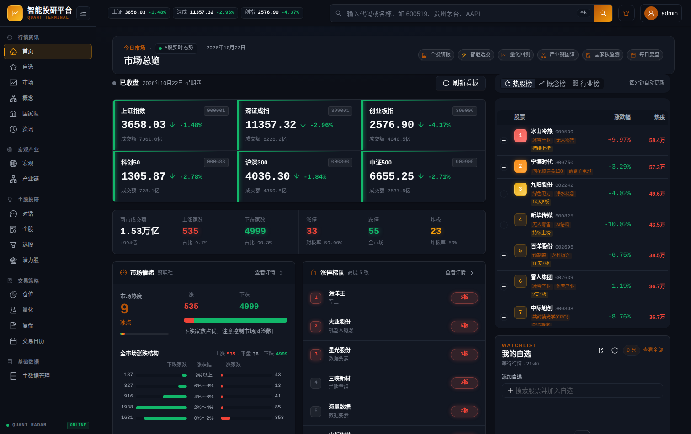
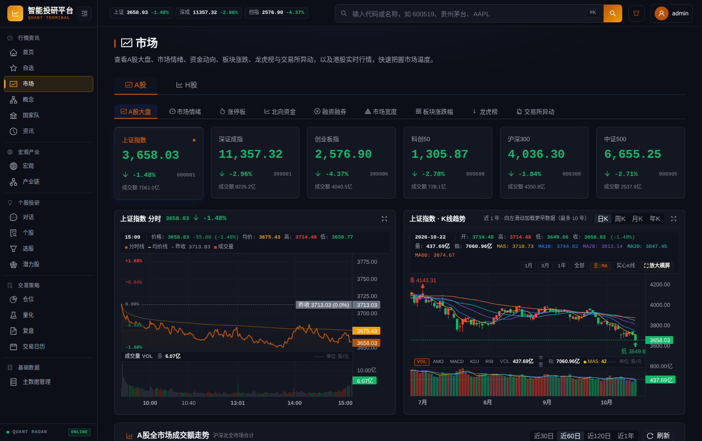
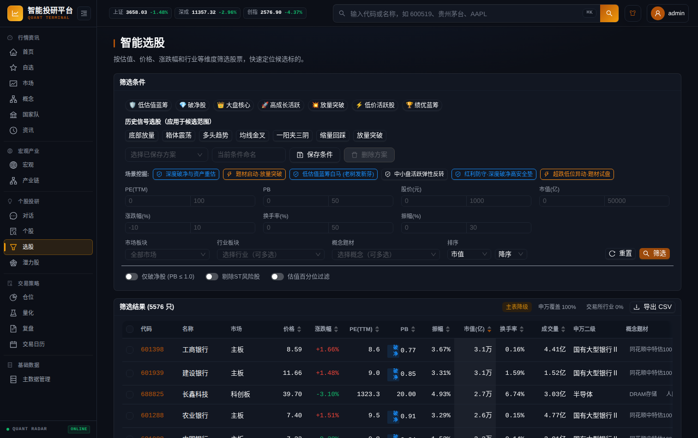
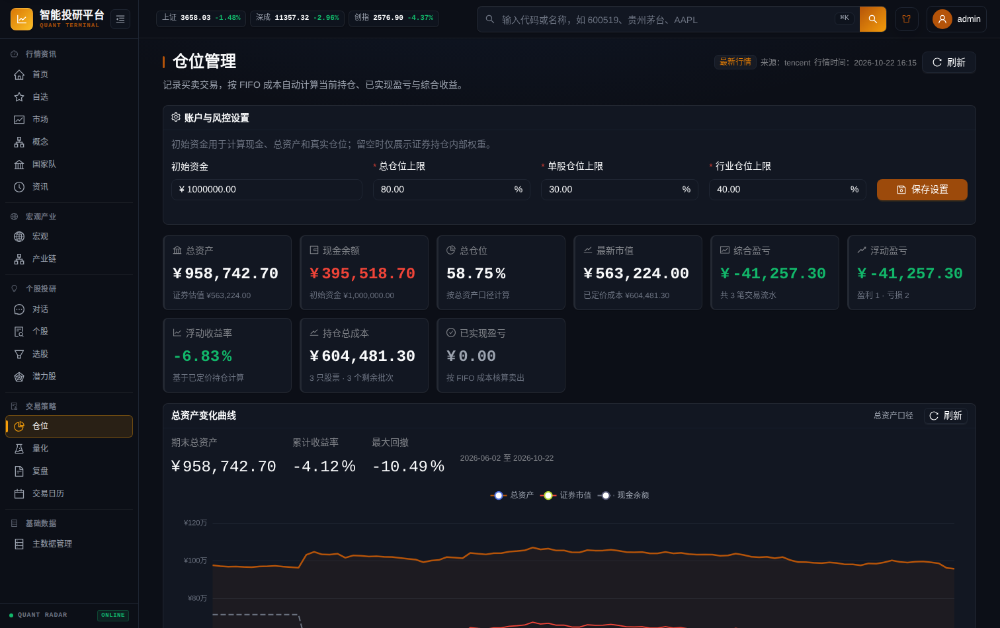
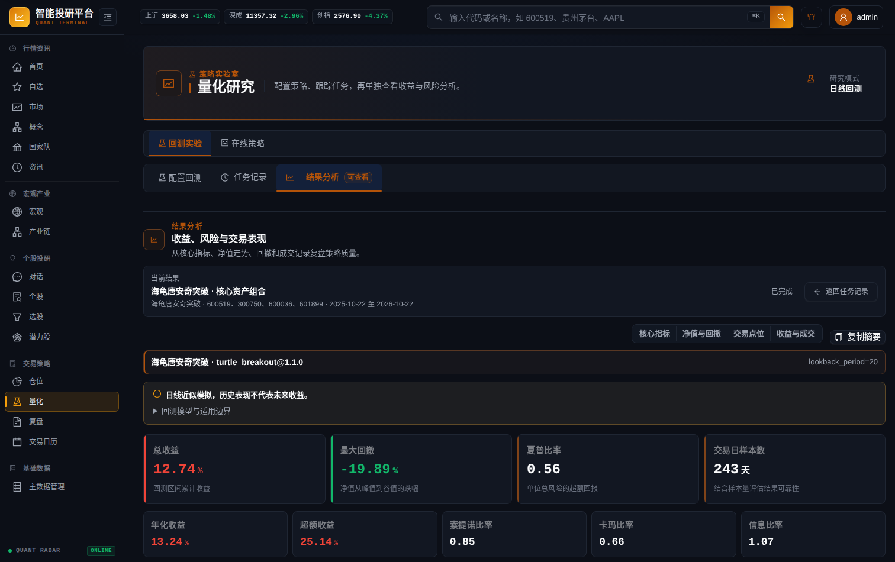
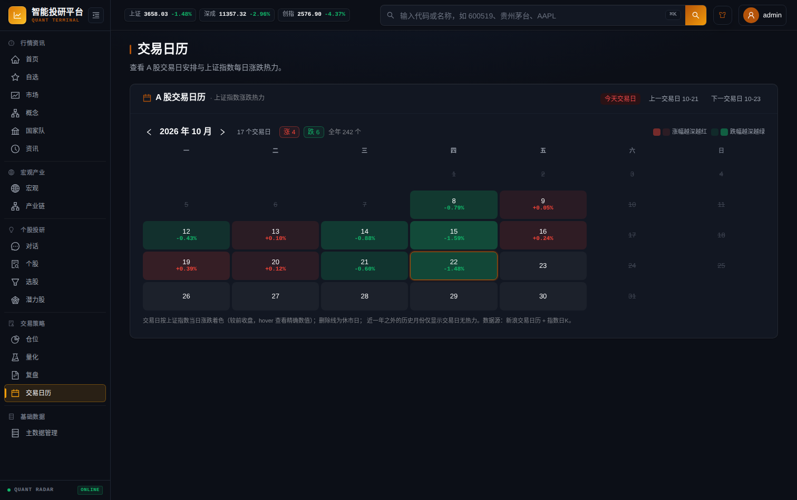
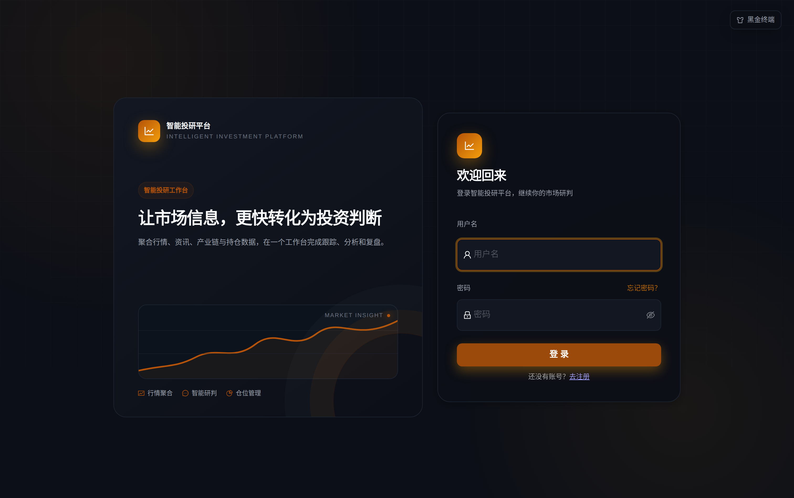

# 智能投研平台

基于 AI 的 A 股多维度智能分析平台，覆盖市场概览、今日主线、热点榜单、涨停复盘、龙虎榜、板块资金、条件选股、每日复盘、个股行情、基本面与估值分析、长期投资研究框架以及 AI 综合研报。内置 AI 选股助手，支持对话式获取实时数据与研报生成。



> [!TIP]
> **第一次部署**：直接看 [快速开始](#快速开始)；只想确认界面效果，看 [界面预览](#界面预览)；
> 遇到报错先查 [常见问题](#常见问题) 与 [故障排查手册](docs/troubleshooting.md)。

## 文档导航

| 文档 | 内容 | 适用场景 |
| :--- | :--- | :--- |
| **README**（本文） | 功能总览、部署、常用配置、常见问题 | 首次评估与部署 |
| [本地开发指南](docs/development.md) | 环境准备、命令表、质量门禁、测试与调试约定 | 参与开发 |
| [架构与边界](docs/architecture.md) | 分层与依赖规则、关键链路、设计取舍 | 深入代码 |
| [配置系统开发指南](docs/configuration.md) | 配置来源、作用域、新增配置项的标准流程 | 改配置 / 加字段 |
| [数据源与降级机制](docs/data-sources.md) | Provider 清单、多源降级、熔断限流、质量校验 | 数据异常排查 |
| [故障排查手册](docs/troubleshooting.md) | 按症状组织的排查步骤与处置命令 | 运维排障 |
| [自动推送与通知配置](docs/push-notifications.md) | 飞书 / 钉钉 / 企微 / 微信服务号接入 | 配置推送 |

---

## 核心特性

### 行情与复盘

- **市场大盘概览**：实时展示主要指数分时走势、成交量分布、自选股列表及今日题材主线（主线题材、龙头股表现、市场风格与板块资金排行）。
- **行情与复盘数据**：指数分时/K线、涨跌停天梯、连板晋级、风向标股票表现、北向资金与融资融券数据。
- **交易日历**：A 股交易日热力视图，按当日涨跌智能着色，支持历史月份切换与休市状态查询。
- **智能每日复盘**：自动聚合市场盘面、热点轮动、资金流向与宏观政策要闻，生成专业结构化复盘报告，支持导出 PDF。

### 选股与潜力挖掘

- **条件与策略选股**：支持多市场板块（主板/创业板/科创板/北交所）、行业、市值、估值百分位及流动性等多维度筛选；支持 7 大量化形态策略扫描。
- **全局股票搜索**：支持 6 位 A 股代码、5 位港股代码及股票名称快速模糊搜索，一键直达个股主页。
- **每日潜力股挖掘**：收盘后从高流动性龙头、中盘活跃与质量中盘三层候选池中，基于策略族信号融合、技术/估值/行业质量叠加、财务基本面二次重排、热门题材加权与“指数趋势+市场情绪”加权挖掘潜力标的，并按行业分散输出，支持历史回溯与 5/10/20 日前瞻收益复盘。

### 个股研究与持仓

- **个股全维分析与长期研报**：
  - **行情与技术指标**：分时、K 线、MACD、RSI、KDJ、筹码分布及缠论笔与中枢分析。
  - **财务与估值**：三张财务报表关键指标、营收/毛利业务构成、DCF 现金流折现情景测算、五种经典估值模型对比及同行对标。
  - **投资研究框架**：盈利引擎、护城河反证、管理层资本配置、行业竞争格局、三情景估值与条件化行动指引。
  - **多源数据互备**：主力资金流向支持多源自动降级与高精度分笔估算。
- **仓位管理与资产净值曲线**：基于交易流水、手续费及历史收盘价，实时绘制账户总资产、持仓市值、累计收益率走势与最大回撤曲线。

### 宏观、资讯与产业链

- **24 小时财经资讯**：聚合主流财经媒体快讯与宏观要闻，AI 提炼核心摘要并标注信源出处。
- **深度产业链分析**：输入产业关键词，AI 自动检索行业研报与产业上下游，生成包含产业链图谱、核心标的业务相关度对比与研报依据的完整报告。
- **全球宏观与 EarthScope**：提供物价、景气、货币、利率、外贸等宏观指标走势；支持港股实时行情、SGE 黄金现货、主要大宗商品期货、美元指数及中美国债利差全景展示。

### AI 助手、量化与协同

- **AI 对话助手**：支持自然语言问答，自动调用行情、资讯、财务及对比工具完成多股横向对比与深度推演。
- **声明式量化研究**：基于安全 YAML DSL 的策略定义与确定性回测引擎，支持移动止损、路径依赖条件及策略在线生成与验证。
- **多端协同与自动推送**：分析报告与每日复盘支持导出高清 PDF 与 Notion 转存；支持交易日收盘后自动推送到**飞书群（富文本交互卡片）、钉钉群（加签 Markdown）、企业微信群**以及**微信服务号（手机端免 App 直达）**，具备事件总线解耦、智能防抖与全链路审计（详见 [自动推送与通知配置指南](docs/push-notifications.md)）。
---

## 界面预览

以下截图取自本地运行实例（真实行情快照、真实申万行业映射与真实回测结果），非设计稿或占位图；
抓取脚本见 [项目开发与维护](#项目开发与维护) 一节。

### 市场行情

指数分时、K 线趋势、涨停梯队与板块资金一屏联动。



### 智能选股

按估值、价格、涨跌幅、行业与概念多维度筛选全市场 5000+ 标的，内置多套场景条件与历史形态信号。



### 仓位管理

按交易流水 FIFO 核算持仓成本，基于历史收盘价绘制总资产、证券市值与累计收益率曲线，并给出最大回撤。



### 量化研究

声明式策略 DSL + 确定性回测引擎，输出核心指标、净值与回撤、交易点位与收益归因。



### 交易日历

A 股交易日热力视图，按当日上证指数涨跌着色，支持月份切换与休市状态查询。



### 登录与访问控制

多租户登录、邀请码注册与首次登录强制改密。



---

## 技术架构

| 分层 | 技术选型 | 说明 |
| :--- | :--- | :--- |
| **前端** | React 18 + TypeScript + Vite + Ant Design 6 | 轻量响应式交互、多主题适配 |
| **图表** | Lightweight Charts + ECharts | 专业金融 K 线、分时走势与复合数据看板 |
| **状态/网络** | Zustand + TanStack Query + SSE | 状态管理、服务端缓存管理与流式长任务推送 |
| **后端** | FastAPI + Python 3.11+ + Pydantic v2 | 高性能异步 API 服务、长任务 Workflow 编排 |
| **存储** | SQLite 3（WAL 模式） | 读写分离架构，按业务划分为用户库、行情库、行业库与历史日线库 |
| **数据源网关** | 统一 Provider Gateway 架构 | 接入 tdxhub、akshare、东方财富、新浪、交易所官方名录、开盘红、AnySearch 等，内置熔断、限流与平滑降级 |
| **AI 引擎** | OpenAI-compatible SDK + LiteLLM | 支持 DeepSeek、通义千问、OpenAI、Claude、Gemini、Azure 及本地 Ollama 等多种模型 |
| **部署环境** | Docker + Docker Compose + Nginx | 容器化部署、自动化数据备份与非 root 安全加固 |

---

## 快速开始

| 方式 | 适合 | 需要 |
| :--- | :--- | :--- |
| Docker 部署（推荐） | 只想用起来 | Docker 20.10+、Docker Compose v2+ |
| 本地开发部署 | 要改代码 | Python 3.11+、uv、Node.js 22、npm |

最短路径三步：`cp .env.example .env` → 生成并填入 `CONFIG_ENCRYPTION_KEY` → `docker compose up -d`，
首次启动会打印初始管理员账号密码。

### 方式一：Docker 部署（推荐）

```bash
# 1. 复制环境变量文件
cp .env.example .env

# 2. 生成配置加密密钥并填入 .env 的 CONFIG_ENCRYPTION_KEY
openssl rand -base64 32 | tr '+/' '-_' | tr -d '\n'; echo

# 3. 编辑 .env 配置必需项（如 LLM_API_KEY）
vim .env

# 4. 创建持久化数据目录并启动
mkdir -p data logs
docker compose up -d

# 5. 查看运行状态与后端日志（首次启动会打印初始管理员账号密码）
docker compose ps
docker compose logs backend
```

启动完成后，浏览器访问 `http://localhost:8080` 即可使用。

> [!TIP]
> - **权限说明**：容器默认以 UID/GID `1000:1000` 运行。如遇到挂载目录权限问题，可执行 `sudo chown -R 1000:1000 data logs`。
> - **端口修改**：如需修改前端映射端口，可在 `.env` 中设置 `DOCKER_FRONTEND_PORT=8081`。

#### 服务拓扑

默认包含 4 个协同容器：
- `backend`：FastAPI 后端主服务（API 接口、异步任务调度、持久化任务引擎）。
- `frontend`：Nginx 静态资源托管与反向代理，对外提供 Web 访问入口。
- `docker-socket-proxy`：受限安全代理，保障容器管理接口的最小权限访问。
- `updater`：在线版本更新执行器，支持一键无感拉取镜像平滑升级。

可选沙箱服务（通过 Compose Profile 启用）：
- `python-runner`（profile: `python-sandbox`）：隔离的安全 Python 代码执行环境。可通过 `make docker-sandbox-up` 启动。

---

### 方式二：本地开发部署

环境要求：Python 3.11+、Node.js 22、uv、npm。

```bash
# 1. 安装前后端依赖与基础运行库
./setup.sh

# 2. 配置环境变量
cp .env.example .env
# 编辑 .env 配置相关 API Key

# 3. 启动开发环境（热重载模式）
./start.sh dev

# 启动后访问 http://localhost:5173
# 停止服务执行：
./stop.sh
```

环境准备、命令表与调试技巧详见 [本地开发指南](docs/development.md)；`make help` 可列出全部指令。

---

## 数据管理与存储

系统采用 SQLite 读写分离与专用库架构（WAL 模式），数据均持久化在 `data/` 目录：

| 数据库文件 | 内容 | 备注 |
| :--- | :--- | :--- |
| `market_data.db` | 市场行情基础缓存、指数与自选数据 | 可从数据源重建 |
| `user_data.db` | 多用户账号、授权、研报版本历史、任务队列 | 含账号与历史报告，**需备份** |
| `industry_data.db` | 申万行业分类、个股概念标签、主营业务资料 | 由种子 + 周期同步维护 |
| `market_daily.sqlite3` | 独立历史日线库与复权因子 | 归档/回填产物，重建成本高 |

四库均支持在线热备与离线恢复，见 [数据备份与离线恢复](#数据备份与离线恢复)。

### 历史日线归档与复权机制

系统具备独立的收盘日线归档机制：
- **交易日归档**：每个交易日收盘后自动执行两阶段快照（16:20 首次预归档，17:00 最终复核确认），完整记录 A 股与港股标的原始未复权 OHLCV。
- **复权因子管理**：基于除权除息记录自动推导精确的前复权、后复权仿射因子。当本地因子可用时，优先本地实时复权计算，大幅降低对外部接口的高频依赖。
- **运维与状态诊断**：管理员可在前端「系统配置 → 行情归档」中查看归档状态、执行手动刷新、失败重试及复权因子健康度检查。
- **全市场历史回填**：管理员可在同一页面选择历史起止日期，创建 A 股个股后台回填任务。任务按 `TDX → 腾讯 → AkShare 新浪 → 东方财富直连 → 新浪直连 → 财联社` 的优先级逐股票拉取未复权日 K，至少使用两个独立来源做日期、OHLC、成交量与成交额一致性校验后才入库；支持断点续跑、质量评分、取消、失败分类，以及“跳过已有数据/覆盖已有数据”两种写入模式。

### 数据备份与离线恢复

后端内置自动化定时备份服务，每天使用 SQLite 在线备份 API 对四个核心数据库进行热备：
- 备份过程自动执行 SQLite 完整性检查（`quick_check`），并采用 gzip（level 9）压缩为 `.sqlite3.gz` 文件，同时生成 SHA-256 校验文件。
- 默认在 `data/db/backups/` 保留最近 2 份历史副本，可通过 `DATABASE_BACKUP_RETENTION_COUNT` 调整，或在「系统配置 → 管理员工具 → 数据库在线备份」中随时修改（保存后下一轮备份即生效）。

#### 离线恢复命令

当需要从备份恢复指定数据库时，在停止容器后执行：

```bash
docker compose down

# 恢复指定数据库（支持 .sqlite3 与 .sqlite3.gz）
docker compose run --rm --no-deps backend \
  python -m app.scripts.restore_database_backup market \
  /app/data/db/backups/market-YYYYMMDDTHHMMSSZ.sqlite3.gz \
  --confirm-backend-stopped

# 恢复完成后重新启动
docker compose up -d
```

### 行业主数据与种子管理

`backend/seeds/` 内置了初始行业分类与概念映射种子文件（约 0.5 MB）。新部署环境在首次启动时会自动播种；日常使用支持通过命令行或前端管理界面导出与维护：

```bash
make backend-db-init          # 初始化数据库结构
make backend-export-seeds     # 将当前运行库的数据导出为新种子
make backend-seed-hot-stocks  # 自动为热门股票补充经营主营资料（默认 TOP=50）
```

---

## 常用服务配置

> [!NOTE]
> 下表只列最常用的配置；**完整变量清单与注释以 `.env.example` 为准**（约 300 行，按业务分组）。
> 配置项的存储位置、作用域（全局 / 用户私有 / 部署级）与新增流程见 [配置系统开发指南](docs/configuration.md)。

### 大模型（LLM）配置

系统支持任意兼容 OpenAI 接口规范的提供商：

```env
LLM_PROVIDER=zhipu
LLM_API_KEY=your_api_key_here
LLM_BASE_URL=https://open.bigmodel.cn/api/paas/v4
LLM_MODEL=GLM-4.7-Flash
LLM_TEMPERATURE=0.1
LLM_TIMEOUT_SECONDS=300
```

> [!NOTE]
> 管理员登录后可在前端「系统配置」页面动态修改全局或默认大模型配置；每个登录用户也可以在个人设置中配置自己独立的 API Key，实现额度与模型隔离。
> 管理员保存的大模型与推送通道配置会自动同步为全局基线，供无用户上下文的常驻后台任务（如收盘自动推送）复用。

### AnySearch 聚合搜索配置

系统内置 `web_search` 检索工具，支持配置 AnySearch 提供高质量的专业网页与财经检索服务：

```env
# 支持配置单个或多个 API Key（多个 Key 逗号分隔，后端按请求轮询）
ANYSEARCH_API_KEY=key_1,key_2,key_3
```

- 未配置 Key 时自动平滑降级使用百度、360 等公共搜索源。
- 管理员可在前端「系统配置 → 数据源管理」中在线更新。

### 飞书推送与 Bot 交互

如需将分析研报、每日复盘推送到飞书，或使用飞书机器人直接进行交互查询，在 `.env` 中配置：

```env
# 飞书推送配置
FEISHU_ENABLED=true
FEISHU_APP_ID=cli_xxxxx
FEISHU_APP_SECRET=xxxxx
FEISHU_FOLDER_TOKEN=fldcnXXXX                    # 云文档目录 Token
FEISHU_WIKI_SPACE_ID=                            # 知识库 Space ID（配置后优先推送到知识库）
FEISHU_DEFAULT_RECEIVER=ou_xxxxx                 # 默认接收人 open_id / chat_id

# 飞书 Bot 交互配置（复用上面的 FEISHU_APP_ID / FEISHU_APP_SECRET）
BOT_ENABLED=true
FEISHU_VERIFICATION_TOKEN=xxxxx
FEISHU_ENCRYPT_KEY=xxxxx
# 仅当 Bot 使用与文档转存不同的飞书应用时才需单独指定（兼容旧部署）
# BOT_FEISHU_APP_ID=cli_yyyyy
# BOT_FEISHU_APP_SECRET=yyyyy
```

- 支持命令：`/analyze <股票代码>`、`/market`、`/status`、`/task <任务ID>` 等。
- 群聊中 `@机器人` 或私聊即可直接触发。

### 问财与 Notion 配置

```env
# 问财自然语言选股
IWENCAI_ENABLED=true
IWENCAI_BASE_URL=https://openapi.iwencai.com
IWENCAI_API_KEY=your_iwencai_api_key

# Notion 研报转存
NOTION_ENABLED=true
NOTION_API_TOKEN=secret_xxx
NOTION_PARENT_PAGE_ID=your_parent_page_id
```

---

## 账号体系与访问安全

系统内置多租户与权限隔离体系：

1. **初始管理员**：
   - 首次启动时自动创建管理员账号（默认用户名 `admin`，可用 `DEFAULT_ADMIN_USERNAME` 覆盖）。
   - **初始密码随机生成并仅在首次启动时打印到后端日志**，首次登录后强制修改密码。
   - 若不用默认管理员而想自己注册首个账号（空库时首个注册者即管理员），且实例在注册前已公网可达，
     请配置 `ADMIN_SETUP_TOKEN`，注册页会要求填写该口令，避免被他人抢先注册成管理员。
2. **邀请码注册**：
   - 普通用户注册必须使用有效邀请码。管理员可在「系统设置 → 邀请码管理」中生成并设置有效期限。
3. **私密配置隔离**：
   - 普通用户的自定义 API Key、个人自选股及历史研报严格隔离，互不可见。
   - 数据源 Cookie、系统服务连接等全局配置仅管理员可见并可修改。
4. **登录设备与审计**：
   - 「系统设置 → 账号与安全」可查看当前账号的全部登录设备（系统/浏览器/IP/最近活跃），并让其他设备下线。
   - 同一处还能查看**自己的登录记录**（成功/失败尝试、来源 IP、设备），便于发现异常登录；全量审计仍仅管理员可见。
   - 登录审计记录成功/失败尝试；管理员操作（改角色、禁用、删除、重置口令、改全局配置等）单独留痕，
     记录操作者、对象与变更字段（不含任何密钥）。两类记录按 `LOGIN_AUDIT_RETENTION_DAYS`（默认 180 天）/
     `ADMIN_AUDIT_RETENTION_DAYS`（默认 365 天）自动清理。
5. **密码策略**：长度 8–128 且必须同时含字母与数字，另拦截高频弱口令、与用户名相同/包含用户名、
   单一字符重复；修改密码与管理员重置都会校验同一套规则。
6. **管理员密码重置（应急救援）**：
   - 如忘记管理员密码，可在服务器直接运行脚本无损重置，不影响任何业务数据：
     ```bash
     # 本地运行
     make backend-reset-admin ADMIN=admin PASS="YourNewPassword"

     # Docker 环境运行
     docker compose exec backend python scripts/reset_admin_password.py admin --password "YourNewPassword"
     ```

---

## 量化研究与 YAML DSL

量化模块支持声明式策略编写、历史回测与在线热加载。

### 示例策略定义

```yaml
api_version: quant.strategy/v1
key: price_above_average
version: 1.0.0
enabled: true
name: 均线突破策略
description: 收盘价上穿指定均线时买入，下穿时平仓
scenario: 趋势行情
risk_level: medium
parameters:
  period:
    type: integer
    label: 均线周期
    default: 20
    minimum: 5
    maximum: 120
indicators:
  average:
    operator: sma
    input: close
    period: $period
signals:
  entry: { operator: greater_than, left: close, right: average }
  exit: { operator: less_or_equal, left: close, right: average }
position: { mode: binary }
```

- **内置算子**：支持 `sma`、`ema`、`rsi`、`rolling_max`、`rolling_min`、`rolling_std`、`obv`、`shift` 及算术运算。
- **回测引擎**：采用确定性回测机制（次日开盘价成交、涨跌停限制校验、佣金及印花税费率模型），回测结果包含净值走势、年化收益率、夏普比率及最大回撤等专业指标。
- **预制策略**：内置双均线、MACD 交叉、布林带反转、海龟唐安奇突破等 18 种经典量化策略。
- **在线策略（自然语言生成）**：任何登录用户都能用一句话生成受限 DSL 草稿、编辑、编译校验并回测自己的策略；「发布到全局策略库」需管理员权限，草稿与回测记录按用户隔离。

---

## 项目开发与维护

| 场景 | 命令 | 说明 |
| :--- | :--- | :--- |
| 启动 / 停止 | `make dev` / `make stop` | 热重载开发模式 |
| 查看状态 | `make status` / `make logs` | 端口与日志 |
| 测试 | `make test` | 后端 pytest + 前端 vitest |
| 质量门禁 | `make check` | Ruff / Mypy / 模块边界 / 覆盖率 / OpenAPI 同步 / 前端测试与构建 |
| 端到端 | `make frontend-e2e` | Playwright smoke 测试 |
| 打包 | `make pack` | 排除密钥、数据与日志 |
| 发版 | `make release V=v0.8.0` | 推送 tag，由 GitHub Actions 构建并发布镜像 |

环境准备、命令全表、质量门禁明细、测试约定与调试技巧（如 `APP_EXPOSE_DOCS=1` 打开 API 文档）
见 [本地开发指南](docs/development.md)。提交前请先本地跑通 `make check`。

### README 界面配图更新

配图由 Playwright 脚本从**本地真实运行实例**抓取（真实行情与真实回测数据），需要前后端已启动：

```bash
# 1. 后端 :8000 + 前端 :4173 均已运行，且存在可登录账号
# 2. 抓图（输出到 docs/images/*.png）
cd frontend
README_SHOT_USER=admin README_SHOT_PASSWORD='你的密码' node scripts/capture-readme-screenshots.mjs
```

脚本只收录「不依赖大模型 Key 也能正常渲染」的页面；对话、每日复盘与产业链报告页需要真实模型
输出才有代表性，故未纳入自动抓取。

### 源码打包归档

```bash
make pack           # 自动排除敏感配置与本地数据，打包生成 stock-agent.tar.gz
```

---

## 常见问题

**Q：没有大模型 API Key 能用吗？**
行情、选股、潜力股、复盘数据、量化回测等**不需要 Key**；AI 研报、对话、每日复盘文字生成需要。
由管理员在「系统设置 → AI 模型配置」配一套即可全站复用；普通用户留空即沿用管理员配置，
自己填了 Key（或换了 Provider / Base URL）才用自己的。界面只有一行状态说明当前用的是哪一套，
留空即继承、改动才会提交，并可一键「改用管理员配置」。为避免管理员 Key 被发到其它地址，**换成自己的端点后必须自备 Key**
（本地 Ollama 这类不需要 Key 的服务除外）。详见 [故障排查：LLM 与 AI 能力](docs/troubleshooting.md#五llm-与-ai-能力)。

**Q：数据从哪来，需要额外付费吗？**
以公开免费数据源为主（通达信、新浪、腾讯、东方财富、交易所官方名录、财联社、国家统计局等），
全市场数据多源交叉校验后才入库；AnySearch、问财、FRED 等为可选的增强源。
清单与降级机制见 [数据源与降级机制](docs/data-sources.md)。

**Q：首次启动的管理员密码在哪看？**
仅在首次启动的后端日志中打印一次。忘记可用
`make backend-reset-admin ADMIN=admin PASS='新密码'` 无损重置（容器环境见
[故障排查](docs/troubleshooting.md#二启动与部署)）。

**Q：只有一个数据库文件吗？会不会写坏？**
四个 SQLite 库分工存储（见 [数据管理与存储](#数据管理与存储)），WAL 模式 + 在线热备，
每天自动备份并校验完整性，支持离线恢复。

**Q：怎么升级到新版本？**
容器部署：`docker compose pull && docker compose up -d`（或使用内置 `updater` 容器一键升级）；
本地开发：`git pull` 后 `./setup.sh` 更新依赖，再跑一次 `make backend-db-init` 应用结构迁移。

**Q：数据会上传到第三方吗？**
除你自己配置的 LLM / 搜索 / 推送服务外，行情与研报数据只保存在本机 SQLite；
API Key 等敏感配置使用 `CONFIG_ENCRYPTION_KEY` 加密后落库。

---

## 免责声明

1. 本平台仅供金融数据研究、量化模型学习与个人开发测试使用，**不构成任何投资建议、荐股或收益承诺**。
2. 市场有风险，投资需谨慎。AI 模型推理分析受限于公开数据与训练假设，可能存在时效滞后或幻觉，请用户务必独立判断并自行承担投资风险。
3. 行情与资讯数据版权归各数据源提供方所有，使用时须遵守其服务条款；请勿将本平台用于商业数据分发。

## 许可证

本仓库未附带 `LICENSE` 文件，按默认规则**保留所有权利**。如需商用、二次分发或对外提供托管服务，
请先与项目作者联系取得授权。
